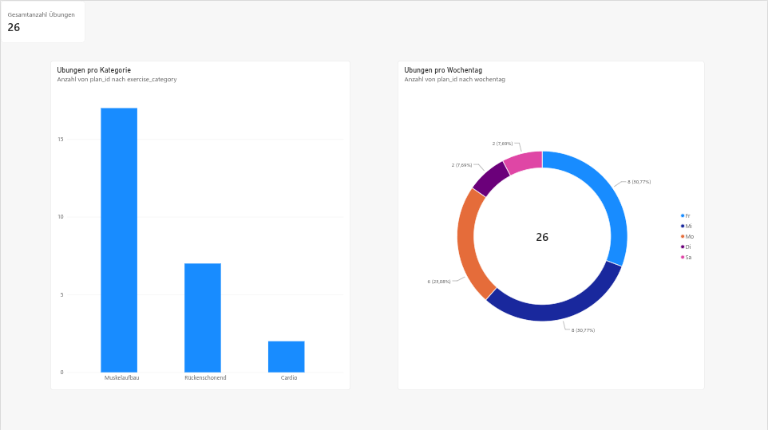

# 🏋️‍♂️ FitFlow – Fitness & Exercise Tracker (MVP)

FitFlow ist eine Full-Stack-Webanwendung zur Verwaltung und Nachverfolgung von Fitness-Workouts. Das Projekt entstand im Rahmen einer Hochschulleistung im Bereich **Agiles Projektmanagement** und deckt den gesamten Zyklus von der Stakeholder-Analyse über Agile User Stories bis hin zum voll funktionsfähigen MVP ab.

Hinweis zur Entstehung: Die Umsetzung von Frontend und Backend erfolgte mit KI-Unterstützung, da der Schwerpunkt des Moduls auf agilem Projektmanagement lag. Datenbankmodell, SQL-Abfragen und Analytics-Auswertung wurden von mir erarbeitet, teilweise mit KI-Hilfe.

---

## 🚀 Features & Stack

- **Frontend:** HTML5, CSS3, JavaScript (Vanilla / DOM-Manipulation)
- **Backend:** Node.js, Express.js (REST API)
- **Datenbank:** MariaDB (Relationales Datenmodell)
- **Analytics Pipeline:** SQL Data Extraction & Power BI Business Intelligence Dashboard
- **Agile Artefakte:** Stakeholderanalyse, User Personas, MoSCoW-priorisiertes Backlog

---

## 🛠️ Installation & Setup

### 1. Voraussetzungen
- [Node.js](https://nodejs.org/) (LTS)
- [MariaDB](https://mariadb.org/) oder MySQL Server

### 2. Datenbank einrichten
1. Erstelle eine lokale MariaDB-Datenbank namens `fitflow`:
   ```sql
   CREATE DATABASE fitflow;
   ```
2. Importiere das Datenbankschema aus dem Repository:
   ```bash
   mysql -u root -p fitflow < database/schema.sql
   ```

### 3. Backend starten
Navigiere in den Backend-Ordner, installiere die Abhängigkeiten und starte den Server:
```bash
cd backend
npm install
node server.js
```
*(Das Backend läuft standardmäßig auf http://localhost:3000)*

### 4. Frontend starten
Öffne die Datei `frontend/index.html` direkt im Browser oder nutze die VS Code Erweiterung **Live Server**.

---

## 📁 Repository-Struktur

```text
fitflow/
├── analytics/          # Data Pipeline (SQL Export, CSV Data & Power BI Reports)
│   ├── dashboard_overview.png
│   ├── export_analytics.sql
│   ├── fitflow_analytics_data.csv
│   ├── FitFlow_Analytics.pdf
│   └── FitFlow_Analytics.zip
├── backend/            # Express REST API & Server-Logik
├── database/           # SQL-Dump (schema.sql)
├── docs/               # Projektdokumentation & Agile Artefakte
│   └── FitFlow_Abschlussprojekt.pdf
└── frontend/           # HTML/CSS/JS Client
```

---

## 📄 Dokumentation

- [Agiles Projektmanagement (PDF)](docs/FitFlow_Abschlussprojekt.pdf) – Detaillierte Übersicht zu Stakeholderanalyse, User Personas und MoSCoW-Backlog.

---

## 📊 Power BI Analytics Dashboard

Zur Auswertung der Trainingsdaten wurde ein Analytics-Workflow aufgebaut:
MariaDB → SQL-Abfrage → CSV-Export → Power BI

Datenquelle: MariaDB (Tabellen users, exercises, wochenplan)
Export: SQL-Abfrage (export_analytics.sql), manuell als CSV exportiert
Visualisierung: Power BI Dashboard mit drei Visuals



Erkenntnisse aus den Beispieldaten (26 Übungen):

Muskelaufbau dominiert mit ca. 65 % der Übungen, Cardio macht nur ca. 8 % aus.
Die meisten Übungen liegen auf Mittwoch und Freitag (zusammen ca. 62 %); Donnerstag und Sonntag sind leer.
```
